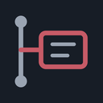
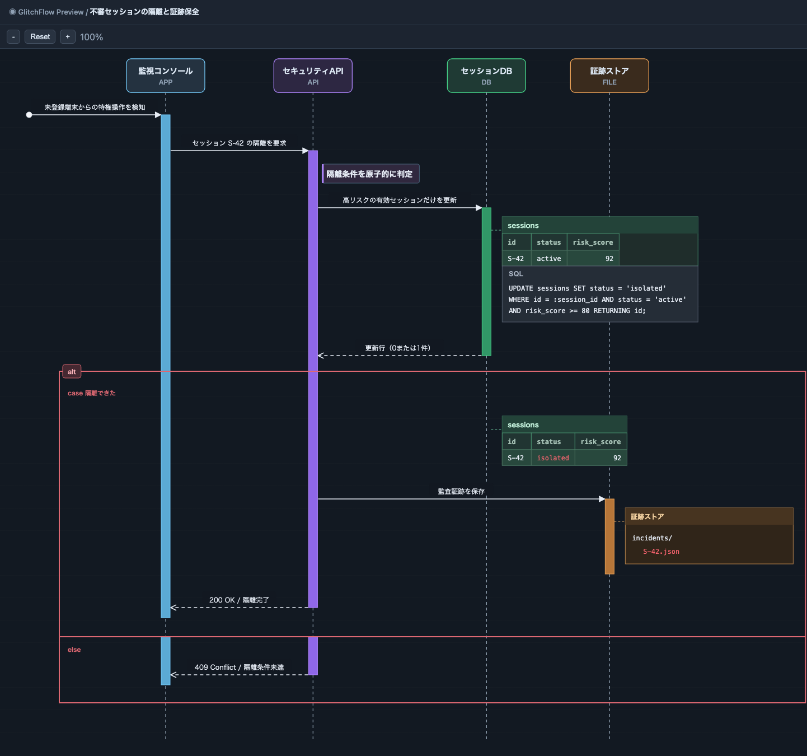

# GlitchFlow



GlitchFlow は、処理の流れ(Flow)とデータの期待状態(State)を同じ時間軸で可視化する VS Code 拡張機能である。\
`.glf` ファイルにメッセージ、処理、分岐、DB レコードやファイルの状態を記述すると、図をプレビューできる。\
設計レビュー、実装時の動作共有、結合テストの期待結果の整理に利用できる。



上の図は、未登録端末からの特権操作を検知し、リスクスコア `92` が閾値 `80` 以上の有効なセッションだけを隔離する流れを表す。\
SQL の前後で `active` から `isolated` への変化を示し、更新したセルだけを赤字にする。\
条件が一致した場合は監査証跡を保存し、一致しなければ更新せずに応答する。\
処理の分岐と、その時点で期待するデータを一緒に確認できる。

## 使い方

1. VS Code で `.glf` ファイルを作成して開くと、右側にプレビューが自動表示される。
2. DSL を編集すると図が更新され、構文や参照の誤りは **Problems** に表示される。
3. VS Code の補完操作からキーワード、定型構文、宣言済みの Object ID とテーブルを入力できる。
4. Object IDまたは`DB.table`/`DB.schema.table`上でVS Codeの「定義へ移動」(F12)と「参照へ移動」(Shift+F12)を使える。\
   同じ場所にHoverするとObject名と種別、またはschemaのカラム名と型が表示される。\
   プレビューのDBカラム名にHoverしても、schemaに明示された型を確認できる。
5. プレビューを手動で開くには、エディタ右上のアイコン、またはコマンドパレットの **GlitchFlow: プレビューを開く** を使う。
6. 図を保存するには、コマンドパレットの **GlitchFlow: 図をエクスポート**、またはプレビューの **図をエクスポート** アイコンを使う。PNGかSVGを選び、保存先を指定する。
7. プレビューのメッセージ、処理、Object、State、SQL、フラグメント見出しや分岐ラベルをクリックすると、対応する`.glf`の行が選択される。

共通のObjectとschemaは、参照元ファイルに `import "./common.glf"` と書くと利用できる。パスはその行を書いたファイルからの相対パスで、複数・多段のimportも使える。import先のメッセージ、state、sql、titleなどは図に取り込まれない。定義名の重複、循環、読み込み失敗はProblemsに表示される。

解析中に誤りがある場合、プレビューは最後に正常に描画できた図を保持する。\
プレビューは縮小、等倍、拡大と縦横スクロールに対応する。\
自動表示は `glitchflow.preview.autoOpen` で切り替えられる。\
`.glf` の構文配色は標準で VS Code のテーマに従い、`glitchflow.syntaxHighlighting` を `glitchflow` にすると専用配色になる。

## DSL の書き方

以下を `session-isolation.glf` として保存すると、上の図を表示できる。\
ファイルは [examples/session-isolation.glf](examples/session-isolation.glf) にもある。

```glf
title: "不審セッションの隔離と証跡保全"

Object APP  as "監視コンソール" type APP
Object API  as "セキュリティAPI" type API
Object DB   as "セッションDB"   type DB
Object FILE as "証跡ストア"     type FILE

schema DB.sessions:
    id: text
    status: text
    risk_score: int

Global ->> APP: 未登録端末からの特権操作を検知
APP+

APP ->> API: セッション S-42 の隔離を要求
API+
API: *隔離条件を原子的に判定*

API ->> DB: 高リスクの有効セッションだけを更新
DB+

state DB.sessions:
    ["S-42", "active", 92]
sql DB:
    UPDATE sessions SET status = 'isolated'
    WHERE id = :session_id AND status = 'active'
    AND risk_score >= 80 RETURNING id;
API <-- DB: 更新行（0または1件）
DB-

alt:
    case 隔離できた:
        state DB.sessions:
            ["S-42", !"isolated", 92]

        API ->> FILE: 監査証跡を保存
        FILE+

        state FILE:
            incidents/
                + S-42.json

        FILE-

        APP <-- API: 200 OK / 隔離完了
        API-
        APP-

    else:
        APP <-- API: 409 Conflict / 隔離条件未達
        API-
        APP-
```

### 基本構文

- `title: "タイトル"`: 図のタイトルを指定する場合は、最初の非空行に 1 回だけ書く。
- `Object ID as "表示名" type 種別`: 登場する対象を宣言する。\
  種別には `APP`、`API`、`DB`、`FILE`、`FEATURE`、`MODULE` を指定できる。\
  `Global` は宣言不要の送信元 ID である。
- `FE ->> BE: 要求` / `FE -> BE: 通知` / `FE --> BE: 応答`: 左の ID から右の ID へ、同期、非同期、応答のメッセージを送る。\
  `FE <<- BE`、`FE <- BE`、`FE <-- BE` は右から左へ向かう。
- `BE: 処理` / `BE: *強調する処理*`: 対象の処理を記述し、前後を `*` で囲むと強調する。
- `BE+` / `BE-`: 活性区間を開始・終了する。\
  開始した区間は終了させる。

### データの期待状態

`schema DB.users:` でカラムを `名前: 型` の形式で宣言する。\
`state DB.users:` にはカラム順の行を `[値, 値]` で並べる。\
参照には `DB.users` のほか、`DB.public.users` のようにスキーマ名も指定できる。\
行頭の `+` と `-` は追加・削除、セル値の先頭の `!` は更新を表す。

```glf
state DB.users:
    + [2, "hanako"]
    [1, !"taro-new"]
    - [3, "old-user"]
```

`state FILE:` ではインデントで階層を表し、行頭の `+` と `-` で追加・削除を示す。\
`sql DB:` には表示したい SQL を複数行で記述できる。\
これらは図に表示するための期待状態であり、DB・ファイル・SQL は実行されない。

### 条件分岐と繰り返し

`alt:` は `case 条件:` と省略可能な `else:` で分岐を記述する。\
`par:` は 2 つ以上の `case 名前:` で並列処理を記述する。\
`opt 条件:`、`loop 条件:`、`break 条件:` は内容を 1 段下げて記述する。\
ブロックのインデントには、タブではなく 4 個ずつの空白を使う。\
活性区間は分岐の出口で一致させる。

```glf
opt キャッシュが有効:
    FE: キャッシュを使う

loop 再試行:
    FE ->> BE: 再送

par:
    case 画面更新:
        FE: 画面を更新
    case 記録:
        BE: 履歴を記録
```

## 開発

Node.js 24 と npm を使用する。

```sh
npm ci
npm run build
npm run check
```

VS Code でリポジトリを開いて F5 を押し、Extension Development Host で [README の例](examples/session-isolation.glf)を開くとプレビューを確認できる。\
回帰テスト用の基準 DSL は [examples/login.glf](examples/login.glf) にある。\
視覚テストは `npx --no-install playwright install chromium` の後に `npm run test:visual` で実行する。\
拡張機能の統合テストは `npm run test:extension` で実行する。

- リポジトリ: [Glitch-Sound/glitchflow](https://github.com/Glitch-Sound/glitchflow)
- 不具合の報告: [Issues](https://github.com/Glitch-Sound/glitchflow/issues)
