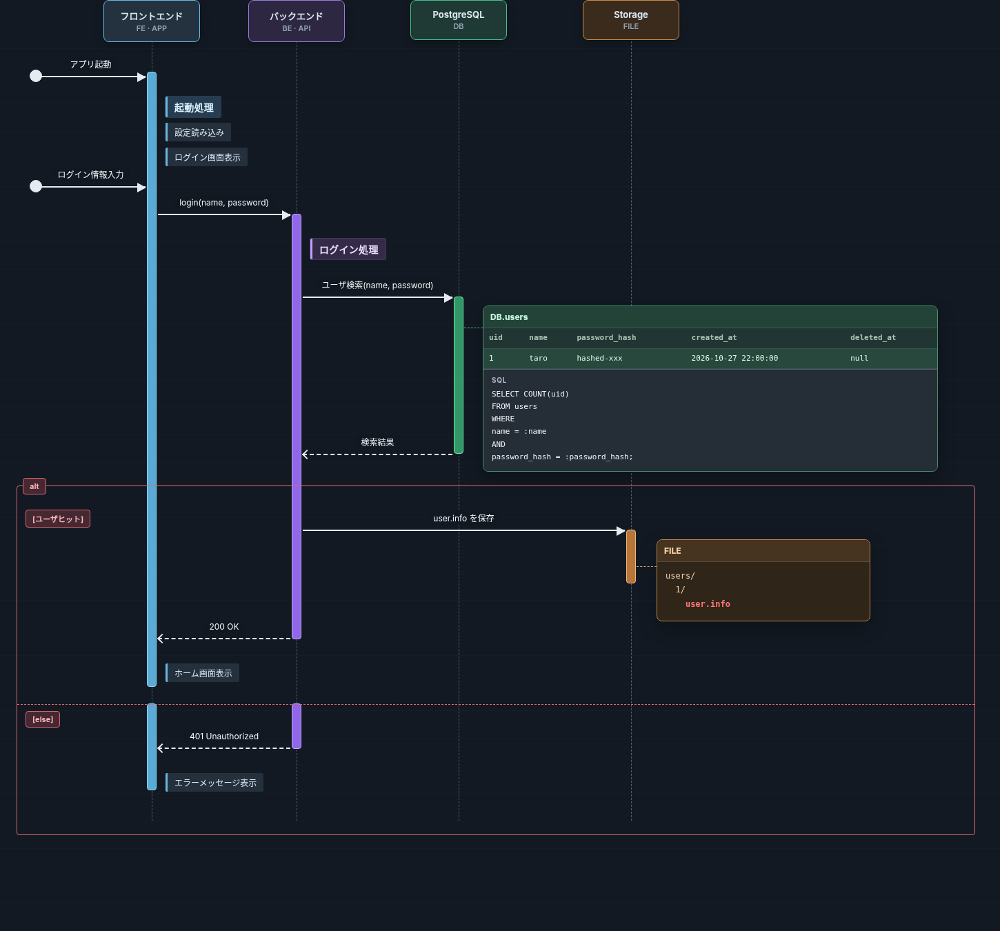

# GlitchFlow

GlitchFlowは、処理の流れ(Flow)とデータの状態(State)を同じ時間軸で可視化するVS Code拡張機能である。\
設計、実装、テストで期待する動作を共有し、認識のずれや設計の考慮漏れを見つけやすくする。



## 主な機能

- `.glf` ファイルに処理やメッセージ、条件分岐を記述し、編集内容を図に反映する。
- 処理の途中にDBレコード、ファイルツリー、SQLを並べ、各時点の期待状態を確認する。
- データの追加、更新、削除を明示し、色や取り消し線で見分ける。
- 構文エラーや参照先の誤りをVS Code上で確認する。

設計レビューでの確認や、実装時の期待動作の共有、結合テストの期待結果の整理に利用することを想定する。\
SQLや業務ファイルを実際に操作する機能は持たず、設計上の期待状態を表示する。

## 現在使える機能

`.glf` ファイルをエディタで開くと、右側にプレビューが自動表示される。
入力フォーカスはエディタに残り、別の`.glf`へ切り替えると同じプレビューが更新される。
自動表示は設定`glitchflow.preview.autoOpen`で無効にできる。
エディタ右上のプレビューアイコン、またはコマンドパレットの`GlitchFlow: プレビューを開く`から手動で表示できる。
プレビューを閉じた後は、同じファイルの編集中に自動で再表示されない。
編集するとプレビューが更新され、構文や参照の誤りはProblemsに表示される。
解析に誤りがある間は最後の正常な図を保持する。

`.glf`の構文配色は標準でVS Codeのテーマに従う。
設定`glitchflow.syntaxHighlighting`を`glitchflow`にすると`.glf`だけに専用配色を適用し、`theme`で標準に戻る。
プレビューの縮小、等倍、拡大ボタンと縦横スクロールで図全体を確認できる。
基準入力は [examples/login.glf](examples/login.glf) に置いてある。

## 開発環境

Node.js 24 と npm を使用する。リポジトリのルートで次を実行する。

```sh
npm install
npx --no-install lefthook install
npm run build
```

VS Code でリポジトリを開き、ビルド後に F5 を押す。`.vscode/launch.json` の構成が Extension Development Host を起動し、`examples/login.glf` を開く。開発ホストで`.glf`を開くとプレビューが右側に表示される。

## 検査

```sh
npm run check
npx --no-install playwright install chromium
npm run test:visual
npm run test:extension
```

`npm run check` は Biome、Webview の FSD 規則、型検査、Core 単体テストを実行する。
`test:visual` は Chromium で図面と表示操作を確認し、`test:extension` は VS Code の Extension Test API で編集連動、Problems、言語設定を確認する。
コミット前は Lefthook がステージ済みファイルの Biome、Webview 全体の Steiger、型検査を実行する。
