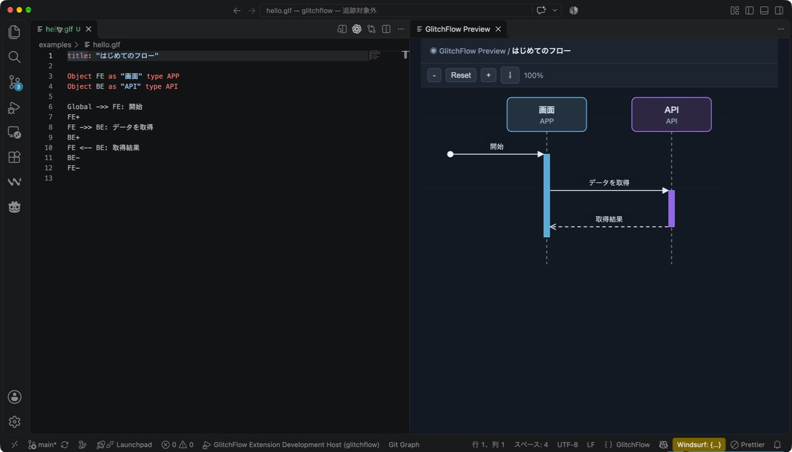
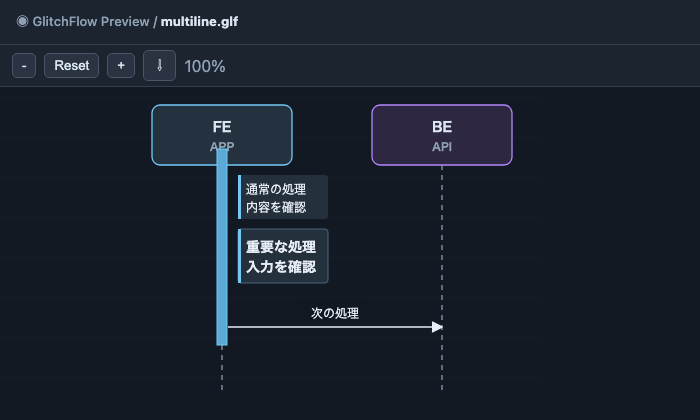

# GlitchFlow

**処理の流れと、各時点のDB・FILEの期待状態を一枚の図に**。

`.glf`をVS Codeで開くと、メッセージ、処理、分岐、データの状態を同じ時間軸で確認できる。

## 3ステップで試す

1. VS Codeの拡張機能で`GlitchFlow`をインストールする。
2. 次の内容を`hello.glf`として保存する。
3. VS Codeで開き、右側のプレビューを確認する。

```glf
title: "はじめてのフロー"

Object FE as "画面" type APP
Object BE as "API" type API

Global ->> FE: 開始
FE+
FE ->> BE: データを取得
BE+
FE <-- BE: 取得結果
BE-
FE-
```



**図の見方:** 左からObject、上から下へ処理順。

同じ入力は[hello.glf](examples/hello.glf)からも取得できる。\
保存した`.glf`は自動でプレビューされ、編集すると図も更新される。\
構文や参照の誤りはVS Codeの**Problems**に表示される。

### 記法の早見表

| 書き方 | 図での表示 |
| --- | --- |
| `title: "名前"` | プレビューの見出し |
| `Object ID as "表示名" type APP` | Objectとライフライン |
| `FE ->> BE: 要求` / `FE -> BE: 通知` | 同期 / 非同期メッセージ |
| `FE <-- BE: 応答` | 応答メッセージ |
| `FE+` / `FE-` | 活性区間の開始 / 終了 |
| `FE: 処理` / `FE: *重要な処理*` | 処理 / 強調された処理 |
| `schema DB.users:` / `state DB.users:` | DBのカラム / 期待状態 |
| `state FILE:` / `sql DB:` | ファイルツリー / 表示用SQL |
| `alt:` / `opt 条件:` / `loop 条件:` | 分岐 / 条件付き処理 / 繰り返し |
| `par:` / `break 条件:` | 並列区画 / 中断区画 |
| `import "./common.glf"` | 別ファイルのObjectとschemaを参照 |

`title`は最初の非空行に記述し、ブロックは4個の空白でインデントする。\
Objectの種別には`APP`、`API`、`DB`、`FILE`、`FEATURE`、`MODULE`を指定できる。\
`state`と`sql`は表示用であり、DBやファイルの操作は実行しない。

### 処理を複数行にする

2行目以降を4個の空白で下げる。

```glf
FE: 処理の1行目
    処理の2行目

FE:
    本文の1行目
    本文の2行目

FE: *重要な処理
    入力を確認*
```



## 状態と分岐を一緒に見る

[セッション隔離のサンプル](examples/session-isolation.glf)では、更新前後のDB、SQL、監査ファイル、成功・失敗の分岐を表示する。


- **図の見方:** 緑の表はDB、橙のツリーはFILE、赤い枠は分岐。
- **DB:** `active`から`isolated`へ更新したセルだけを赤字で表示。
- **FILE:** 追加した`S-42.json`を赤字で表示。
- **分岐:** `alt`の成功経路と失敗経路を別の区画に表示。

## VS Codeでの操作

| やりたいこと | 操作 |
| --- | --- |
| プレビューを開く | `.glf`を開く / エディタ右上のアイコン / `GlitchFlow: プレビューを開く` |
| 図から記述へ移動 | 図のメッセージ・処理・Stateなどをクリック |
| 定義へ移動 / 参照を検索 | Object IDやDBテーブル参照で`F12` / `Shift+F12` |
| 型や種別を見る | DSLのObject・テーブル、図のDBカラム名にHover |
| 入力を補完 | VS Codeの補完操作で構文や宣言済みIDを選択 |
| 図を拡大・縮小 | プレビュー左上の`-` / `Reset` / `+` |
| 画像を保存 | プレビューのエクスポートアイコン / `GlitchFlow: 図をエクスポート` |

画像は**PNG**または**SVG**で、スクロール外を含む図全体を保存できる。\
解析エラーがある間は、最後に正常に描画できた図を保持する。

### 設定

| 設定 | 既定値 | 内容 |
| --- | --- | --- |
| `glitchflow.preview.autoOpen` | `true` | `.glf`を開いたときの自動プレビュー |
| `glitchflow.syntaxHighlighting` | `theme` | `theme`: VS Codeの配色 / `glitchflow`: 専用配色 |

## さらに試す

- [最小のフロー](examples/hello.glf): Object、メッセージ、活性区間。
- [ログインフロー](examples/login.glf): DB表、SQL、FILEツリー、`alt`分岐。
- [セッション隔離](examples/session-isolation.glf): 更新セル、監査ファイル、条件による分岐。
- [複合フラグメント](examples/other-fragments.glf): `opt`、`loop`、`par`、`break`。

## 開発

Node.js 24とnpmを使用する。

```sh
npm ci
npm run build
npm run check
```

VS Codeでリポジトリを開き、`F5`でExtension Development Hostを起動する。\
視覚テストは`npm run test:visual`、拡張機能の統合テストは`npm run test:extension`で実行する。

[リポジトリ](https://github.com/Glitch-Sound/glitchflow) / [不具合の報告](https://github.com/Glitch-Sound/glitchflow/issues)
