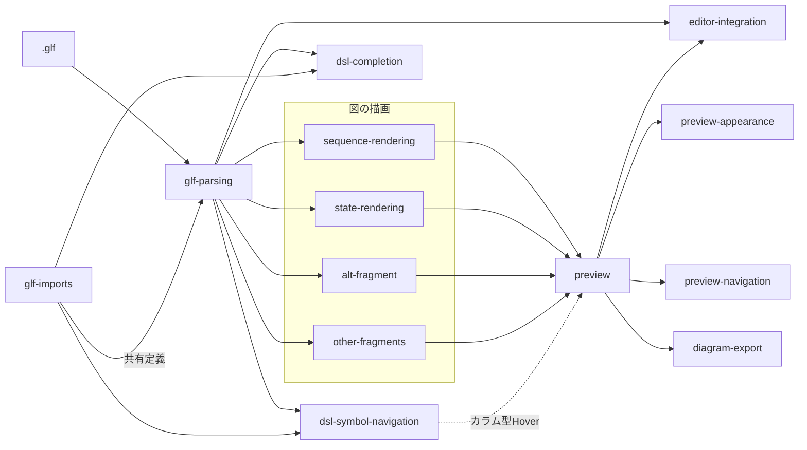

# 仕様の読み方

このディレクトリには、GlitchFlowの機能ごとの正式仕様を置く。\
各`spec.md`の`Purpose`はその機能の目的、`Requirements`は満たすべき振る舞い、`Scenario`は具体的な確認例を示す。\
製品全体の目的と用語は[product.md](../product.md)、仕様と実装・テストの対応は[traceability.md](../traceability.md)を参照する。\
進行中の変更がある場合は、[changes](../changes)配下の差分仕様も確認する。

## 全体像

`.glf`の解析結果を、図の描画、エディタの支援、画像の出力で利用する。\
以下は機能を理解するための関係であり、実装の呼び出し順を示すものではない。

`glf-parsing`は文書をIR(描画などが共有する解析結果)へ変換し、構文や参照の誤りを診断する。\
`glf-imports`は別ファイルのObjectとschemaを解決し、解析・補完・プレビューで共有する定義を広げる。\
描画に関する4つの仕様は、解析結果のどの要素を図へどう配置するかを分担する。\
`preview`はVSCodeから図を開く入口とパネルの扱いを定める。\
その上に外観、図からDSLへの移動、画像出力の仕様が加わる。\
`editor-integration`は編集中の更新や診断など、エディタとプレビューをつなぐ振る舞いを定める。

## 各仕様の役割

| 仕様 | 主な役割 | 関連する仕様 |
| --- | --- | --- |
| [glf-parsing](glf-parsing/spec.md) | 基本構文・状態・分岐のIR化と診断 | glf-imports、各描画仕様 |
| [glf-imports](glf-imports/spec.md) | Object・schemaの共有とインポート診断 | glf-parsing、dsl-completion、dsl-symbol-navigation |
| [sequence-rendering](sequence-rendering/spec.md) | Object・メッセージ・活性・処理の時間軸上の描画 | glf-parsing、state-rendering、各フラグメント仕様 |
| [state-rendering](state-rendering/spec.md) | DB・FILEのStateとSQLの描画 | glf-parsing、sequence-rendering、preview-appearance |
| [alt-fragment](alt-fragment/spec.md) | 排他的な`alt`分岐の描画と活性検証 | glf-parsing、sequence-rendering、other-fragments |
| [other-fragments](other-fragments/spec.md) | `opt`・`loop`・`par`・`break`の描画と診断 | alt-fragment、sequence-rendering |
| [preview](preview/spec.md) | 起動・自動表示・単一パネルの再利用 | 各描画仕様、editor-integration |
| [preview-appearance](preview-appearance/spec.md) | 図の色・形・カード・ラベル・余白 | 各描画仕様、preview |
| [editor-integration](editor-integration/spec.md) | 編集連動・Problems診断・DSL配色・表示倍率 | glf-parsing、preview |
| [dsl-completion](dsl-completion/spec.md) | 構文Snippetと参照の文脈別補完 | glf-parsing、glf-imports |
| [dsl-symbol-navigation](dsl-symbol-navigation/spec.md) | 定義移動・参照検索・型情報Hover | glf-imports、preview |
| [preview-navigation](preview-navigation/spec.md) | 図の要素から対応するDSL行への移動 | preview、glf-parsing、editor-integration |
| [diagram-export](diagram-export/spec.md) | 図全体のPNG・SVG保存 | preview、各描画仕様、preview-appearance |

## 目的別の読み順

- **まず全体を知る:** [product.md](../product.md) -> [glf-parsing](glf-parsing/spec.md) -> [sequence-rendering](sequence-rendering/spec.md) -> [state-rendering](state-rendering/spec.md) -> [preview](preview/spec.md)。
- **DSLの記述と参照を調べる:** [glf-parsing](glf-parsing/spec.md) -> [glf-imports](glf-imports/spec.md) -> [dsl-completion](dsl-completion/spec.md) -> [dsl-symbol-navigation](dsl-symbol-navigation/spec.md)。
- **分岐や活性を調べる:** [glf-parsing](glf-parsing/spec.md) -> [sequence-rendering](sequence-rendering/spec.md) -> [alt-fragment](alt-fragment/spec.md) -> [other-fragments](other-fragments/spec.md)。
- **図の表示や操作を調べる:** [preview](preview/spec.md) -> [preview-appearance](preview-appearance/spec.md) -> [editor-integration](editor-integration/spec.md) -> [preview-navigation](preview-navigation/spec.md) -> [diagram-export](diagram-export/spec.md)。

特定の動作を確認するときは、該当する仕様の要件IDとScenarioを読み、[traceability.md](../traceability.md)で実装・テスト・検証結果を追う。
